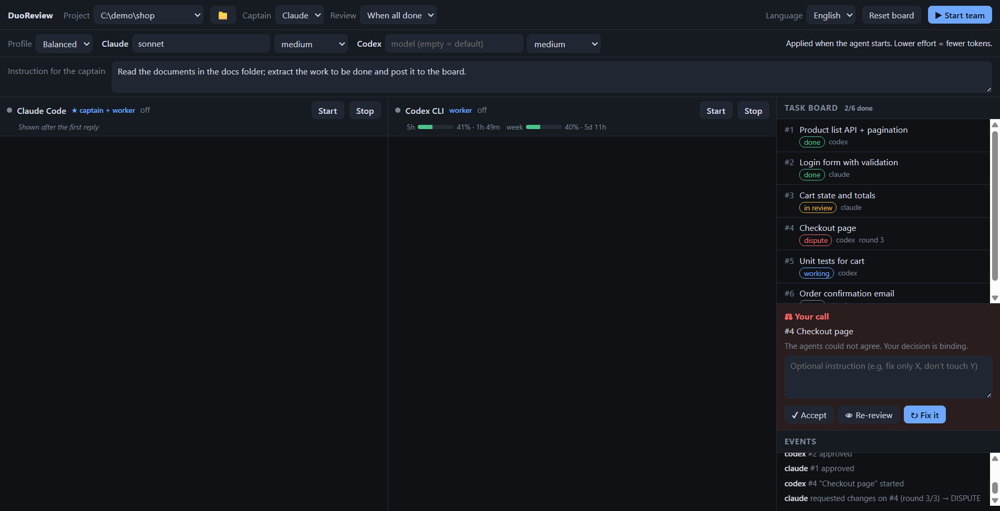

# DuoReview

**Let Claude Code, Codex and Gemini split a job, review each other's work, and hand you the final call when they disagree.**

[Türkçe](README.tr.md) · MIT · Node ≥ 22.13 · Windows ✔ · macOS/Linux: untested, see [Limitations](#limitations)


*Screenshot with demo data.*

DuoReview is an [MCP](https://modelcontextprotocol.io) server plus a small Electron app. It runs the
`claude`, `codex` and `agy` (Antigravity CLI, for Gemini) CLIs side by side in up to three terminals and gives them one shared task board.

## Why

A single model that writes and then reviews its own code tends to grade its own homework. Models from
different vendors have different blind spots, so here **every task is reviewed by another vendor's agent**: in a team of three
Codex reviews Claude, Gemini reviews Codex and Claude reviews Gemini; in a pair the two review each other.

- **Pick the team.** Claude + Codex + Gemini, or any two of them (header menu). Without `agy` installed the team defaults to Claude + Codex.
- **Every agent thinks first.** With the default kickoff, each agent works on your brief on its own (reading the code, researching the web if you asked for that) and writes a note. The notes stay hidden from each other until all are in, so a later one is not a paraphrase of an earlier one. Then they argue the differences; turns rotate, and a discussion closes in agreement once everyone except the author of the last proposal agrees.
- **Captain + workers.** One agent (you choose which) merges the notes into small tasks, split evenly. The other agents have to agree to the plan or object before anyone starts.
- **Discussions you can read.** Notes and every discussion are in the *Notes and discussion* tab, side by side, and export to one Markdown file. A discussion that hits its message limit without agreement is marked *split* so you can see where they disagreed.
- **Cross-review.** Nobody reviews their own task. Only `blocker` / `major` findings can block a task; minor notes do not.
- **Evidence, not summaries.** When a task is taken and when it is submitted, the server snapshots the working tree (through a temporary git index; your index and files are untouched). The reviewer gets the task's own diff, without the partners' changes in the same folder, plus the files changed outside the task's `touches` (`unclaimed`).
- **Acceptance criteria.** The captain gives each task measurable `acceptance` criteria. The reviewer marks every one with `{ok, evidence}` (file:line, command output, test name); a task with an unmet criterion cannot be approved.
- **Better ideas are not lost.** A reviewer who sees a simpler, faster or algorithmically better way writes it in `alternative`. Before the job counts as done, the captain must `adopt` it (it becomes a new task, by default for the proposer) or `reject` it with a technical reason; both are logged.
- **Verify gate.** An optional command (e.g. `npm test`) runs in the project folder on every `submit_task`; if it fails, the task stays with its owner and the output goes back to the agent.
- **Project skills.** The Skills button copies a skill folder (with `SKILL.md`) into the project: `.claude/skills` for Claude, `.agents/skills` for Codex and Gemini (agy). It applies only in that folder, no plugin install.
- **You break ties.** After 3 review rounds without agreement the task becomes a *dispute* and the decision is yours: accept, re-review, or send it back with your instruction.
- **File-conflict guard.** Each task lists the files it touches; an agent cannot start a task that overlaps with a partner's unfinished one (tasks waiting in review count as unfinished).
- **Quota aware.** Live 5-hour and weekly usage meters. When a quota is full, the app stops nudging that agent instead of burning tokens.
- **Task dependencies.** A task can name tasks that must be done first (`depends_on`, by `key` within the same plan); it cannot be started before they are approved.
- **Lean on tokens.** A reply to `submit_task`, `review_task`, `post_note`, `discuss` and `post_tasks` carries the next step, and `next_action` takes the next task by itself, so a plain task (take, submit, reviewer wakes, review) takes four tool calls in the measured scenario (`npm run tokens`); kickoff, discussions and rework rounds come on top. The header shows each agent's tool calls and characters sent/received (counted by the MCP server; not tokens). The task spec is sent once per session (`status(id)` returns it again), replies are small, and effort/model profiles (economy / balanced / powerful) are one click away. The model menus list every model your CLIs offer (Codex's from its own cache), with the effort levels each one supports.
- **Style rules for the agents.** The rules sent to both agents ban the usual filler in code and prose: comments that restate the code, unrequested abstractions and files, openers, closing recaps, praise, emoji. Reviewers treat unrequested files and unrelated changes as `major`.
- **Leaves your global config alone where the CLI allows it.** MCP wiring is passed per session (`--mcp-config` for Claude, `-c` overrides for Codex). `agy` reads MCP servers and tool permissions only from its global settings, so when Gemini starts the app adds a `duoreview` server (`agy mcp add`) and the `mcp(duoreview/*)` permission, and removes both when Gemini stops. Board data is stored outside your project, so your repo stays clean.
- **English and Turkish UI, prompts and tool texts** (language menu in the header).

## Quick start

Requirements: Node.js ≥ 22.13, and the `claude` and `codex` CLIs installed and logged in. For Gemini, the Antigravity CLI (`agy`) installed and signed in;
Google no longer lets personal accounts use Gemini CLI, so DuoReview drives `agy` instead. On Windows: `irm https://antigravity.google/cli/install.ps1 | iex`, then run `agy` once to sign in.

```powershell
npm install
npm run app -- --project "C:\path\to\your\project"
```

Then pick the team and the captain, write a brief ("add a login page and its tests", or "analyse this project and list what is missing"), and press **Start team**.
The app starts the agents in your project folder, wires up the MCP server and types one short line into each terminal; the rules and your brief reach the agents through the MCP server.

Kickoff has two settings. *All analyse and discuss* is the default and costs more tokens: one analysis per agent plus up to 4 messages each for the kickoff and the plan (6 with three agents). *Captain plans alone* skips that and goes straight to the task board.

Other commands:

| Command | What it does |
|---|---|
| `npm run build` | Compile the MCP server (`tsc`) |
| `npm start` | Run the MCP server alone over stdio (needs `AGENT_ID` and `DUOREVIEW_DIR`) |
| `npm test` | Build and run all tests (no model quota is used) |

### Using the MCP server without the app

Set the same `DUOREVIEW_DIR` for every agent and a different `AGENT_ID` (`claude` / `codex` / `gemini`):

```json
{
  "mcpServers": {
    "duoreview": {
      "command": "node",
      "args": ["/path/to/dist/server.js"],
      "env": { "AGENT_ID": "claude", "DUOREVIEW_DIR": "/path/to/shared-data", "DUOREVIEW_LANG": "en" }
    }
  }
}
```

Tools: `next_action`, `post_tasks`, `assign_task`, `drop_task`, `claim_task`, `submit_task`, `review_task`, `status`, `post_note`, `discuss`, `open_thread`, `read_thread`, `send_prompt`, `read_inbox`, `triage`.
`next_action` hands the agent its next task directly; `claim_task` is only for picking a specific one. `status(id)` returns one task in full.
Set the kickoff with a row in the `meta` table (`kickoff` = `joint` or `solo`, default `solo`) and the team with `team` (e.g. `claude,codex,gemini`, default `claude,codex`); the app does this for you.
See [TEAM.md](TEAM.md) for the loop the agents follow.

## How it works

```
Claude Code  ─┐
Codex CLI    ─┼─ MCP ─ duoreview ─ SQLite task board
Gemini (agy) ─┘                          ▲
   Electron app: terminals, board, referee (nudges idle agents), usage meters, dispute panel
```

Before the board: `ANALYZE` (every agent, independently) `→ DISCUSS → PLAN → DISCUSS` (plan approval).
Task states: `TODO → WORKING → REVIEW → DONE`, with `REWORK` (up to 3 rounds) and `DISPUTE`.

The referee writes to an agent's terminal only when it is idle and no approval question or menu is on screen
(including Codex's update and folder-trust menus and `agy`'s folder-trust question at startup). It waits for the echo to settle before pressing Enter
and presses again if the agent did not start working, because Codex treats an Enter that arrives during a fast burst of characters as a newline.

## Benchmarking on SWE-bench

`bench/swebench.mjs` runs the same SWE-bench instances with one agent and with a team, writes the patches in SWE-bench's format, scores them with the official harness and compares the runs.
It drives the CLIs in their non-interactive modes (`claude -p --resume`, `codex exec resume`, `agy -p --conversation`): no terminal, no approval prompts.
**Claude and agy run without permission checks** (their CLIs have no workspace sandbox) inside throwaway clones under `bench/work`, with your user rights and environment. Codex runs in its own `workspace-write` sandbox (`--codex-sandbox danger-full-access` turns it off). Use a VM or container you accept that on; `run` refuses without `--yes`.

```powershell
npm run bench -- fetch --dataset verified --per-repo 1         # one instance per repository -> bench/work/data
npm run bench -- run --mode gold                               # the reference fixes (no agents)
npm run bench -- eval --name gold                              # which instances pass on this machine at all
npm run bench -- run --mode claude --valid --yes               # baseline: Claude alone, only instances whose reference fix passes
npm run bench -- run --mode codex --valid --yes                # baseline: Codex alone
npm run bench -- run --mode team --team claude,codex --valid --yes # DuoReview team
npm run bench -- eval --name claude                            # official harness in Docker (once per run)
npm run bench -- report                                        # bench/work/report.md
```

Run the reference fixes first: some tests need network or a platform the local Docker does not provide, and an instance whose reference fix fails here cannot be solved by anyone. `--valid` keeps only the instances that `gold` resolved.
Each instance is checked out at its base commit without history, so an agent cannot find the fix with `git log`. The problem statement is the brief; hints and the hidden tests are not shown.
Options: `--ids a,b`, `--limit`, `--timeout <min>` (default 60), `--captain`, `--kickoff solo|joint`, `--review immediate|after_all`, `--verify "<cmd>"`, `--model-claude`, `--effort-codex`, and so on. A stopped run resumes where it left off.
`eval` needs Docker: it runs `swebench` in a `python:3.11` container with the Docker socket mounted, and pulls several GB of images per repository. The report lists resolved instances, time, turns, tokens, Claude's cost, change requests, disputes and what happened to the alternatives.
Some repositories contain paths Windows cannot check out; those instances are recorded as `setup_failed` and skipped.

## Limitations

- Developed and tested on **Windows**. On macOS/Linux the `claude`/`codex` lookup goes through `PATH`, but that path has not been run on a real Mac or Linux box yet (CI runs the non-Electron tests on Ubuntu). Reports welcome.
- If a CLI is installed somewhere unusual, point to it: `DUOREVIEW_CLAUDE_BIN=/path/to/claude`, `DUOREVIEW_CODEX_BIN=/path/to/codex`, `DUOREVIEW_GEMINI_BIN=/path/to/agy`.
- All agents share one working directory (conflicts are prevented with the `touches` check, not git worktrees).
- Two or three agents: Claude Code, Codex CLI and Gemini through the Antigravity CLI.
- Gemini's MCP entry is global, so run Gemini in one DuoReview window at a time. There is no usage meter for Gemini yet.
- Source-only distribution for now: run it from a clone (`npm install` + `npm run app`). No npm package or packaged installer yet.
- `node:sqlite` is still experimental in Node, so you will see a warning.

## Security

The agents run with **your** user rights in **your** project folder. For Codex, the DuoReview MCP tools are auto-approved
(`default_tools_approval_mode="approve"`); for Claude only the `mcp__duoreview` tools are pre-allowed; for Gemini `mcp(duoreview/*)` is in `permissions.allow` while it runs. Everything else
still goes through each CLI's normal approval prompts, and the referee never presses Enter on an approval question for you.
Credentials stay in the CLIs' own stores (`~/.claude`, `~/.codex`, `~/.gemini`); DuoReview does not read, store or send them (it only reads usage percentages from local Codex session logs for the meters). DuoReview itself never touches the network; to fill Gemini's model menu it runs `agy models`, which asks Google's servers.
Use it on projects you would be comfortable letting a coding agent edit, and keep commits/pushes manual.

## Roadmap

- Git worktree per agent plus a diff view and merge step
- macOS/Linux support

## License

[MIT](LICENSE)
