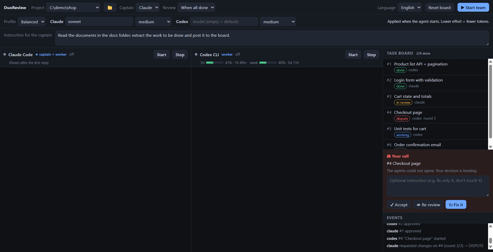

# DuoReview

**Let Claude Code and Codex split a job, review each other's work, and hand you the final call when they disagree.**

[Türkçe](README.tr.md) · MIT · Node ≥ 22.13 · Windows ✔ · macOS/Linux: untested, see [Limitations](#limitations)


*Screenshot with demo data.*

DuoReview is an [MCP](https://modelcontextprotocol.io) server plus a small Electron app. It runs the
`claude` and `codex` CLIs side by side in two terminals and gives them one shared task board.

## Why

A single model that writes and then reviews its own code tends to grade its own homework. Models from
different vendors have different blind spots, so here **Claude's work is reviewed by Codex and the other way around**.

- **Both agents think first.** With the default kickoff, each agent works on your brief on its own (reading the code, researching the web if you asked for that) and writes a note. The notes stay hidden from each other until both are in, so the second one is not a paraphrase of the first. Then they argue the differences.
- **Captain + worker.** One agent (you choose which) merges the two notes into small tasks, split evenly. The other agent has to agree to the plan or object before anyone starts.
- **Discussions you can read.** Notes and every discussion are in the *Notes and discussion* tab, side by side, and export to one Markdown file. A discussion that hits its message limit without agreement is marked *split* so you can see where they disagreed.
- **Cross-review.** Nobody reviews their own task. Only `blocker` / `major` findings can block a task; minor notes do not.
- **You break ties.** After 3 review rounds without agreement the task becomes a *dispute* and the decision is yours: accept, re-review, or send it back with your instruction.
- **File-conflict guard.** Each task lists the files it touches; an agent cannot start a task that overlaps with a partner's unfinished one.
- **Quota aware.** Live 5-hour and weekly usage meters. When a quota is full, the app stops nudging that agent instead of burning tokens.
- **Task dependencies.** A task can name tasks that must be done first (`depends_on`); it cannot be started before they are approved.
- **Lean on tokens.** A reply to `submit_task`, `review_task`, `post_note`, `discuss` and `post_tasks` carries the next step, and `next_action` takes the next task by itself, so a plain task (take, submit, reviewer wakes, review) takes four tool calls in the measured scenario (`npm run tokens`); kickoff, discussions and rework rounds come on top. The header shows each agent's tool calls and characters sent/received (counted by the MCP server; not tokens). The task spec is sent once per session (`status(id)` returns it again), replies are small, and effort/model profiles (economy / balanced / powerful) are one click away. The model menus list every model your CLIs offer (Codex's from its own cache), with the effort levels each one supports.
- **Style rules for the agents.** The rules sent to both agents ban the usual filler in code and prose: comments that restate the code, unrequested abstractions and files, openers, closing recaps, praise, emoji. Reviewers treat unrequested files and unrelated changes as `major`.
- **Does not touch your global config.** MCP wiring is passed per session (`--mcp-config` for Claude, `-c` overrides for Codex). Board data is stored outside your project, so your repo stays clean.
- **English and Turkish UI, prompts and tool texts** (language menu in the header).

## Quick start

Requirements: Node.js ≥ 22.13, and the `claude` and `codex` CLIs installed and logged in.

```powershell
npm install
npm run app -- --project "C:\path\to\your\project"
```

Then pick the captain, write a brief ("add a login page and its tests", or "analyse this project and list what is missing"), and press **Start team**.
The app starts both agents in your project folder, wires up the MCP server and types one short line into each terminal; the rules and your brief reach the agents through the MCP server.

Kickoff has two settings. *Both analyse and discuss* is the default and costs more tokens: two analyses plus up to 4 messages each for the kickoff and the plan. *Captain plans alone* skips that and goes straight to the task board.

Other commands:

| Command | What it does |
|---|---|
| `npm run build` | Compile the MCP server (`tsc`) |
| `npm start` | Run the MCP server alone over stdio (needs `AGENT_ID` and `DUOREVIEW_DIR`) |
| `npm test` | Build and run all tests (no model quota is used) |

### Using the MCP server without the app

Set the same `DUOREVIEW_DIR` for both agents and a different `AGENT_ID` (`claude` / `codex`):

```json
{
  "mcpServers": {
    "duoreview": {
      "command": "node",
      "args": ["/path/to/dist/server.js"],
      "env": { "AGENT_ID": "claude", "DUOREVIEW_DIR": "/path/to/shared-data", "DUOREVIEW_LANG": "en" }
    }
  }
}
```

Tools: `next_action`, `post_tasks`, `assign_task`, `drop_task`, `claim_task`, `submit_task`, `review_task`, `status`, `post_note`, `discuss`, `open_thread`, `read_thread`, `send_prompt`, `read_inbox`.
`next_action` hands the agent its next task directly; `claim_task` is only for picking a specific one. `status(id)` returns one task in full.
Set the kickoff with a row in the `meta` table (`kickoff` = `joint` or `solo`, default `solo`); the app does this for you.
See [TEAM.md](TEAM.md) for the loop the agents follow.

## How it works

```
Claude Code ─┐                       ┌─ Codex CLI
             ├─ MCP ─ duoreview ───┤
 (terminal)  ┘   SQLite task board   └─ (terminal)
                       ▲
   Electron app: terminals, board, referee (nudges idle agents), usage meters, dispute panel
```

Before the board: `ANALYZE` (both, independently) `→ DISCUSS → PLAN → DISCUSS` (plan approval).
Task states: `TODO → WORKING → REVIEW → DONE`, with `REWORK` (up to 3 rounds) and `DISPUTE`.

The referee writes to an agent's terminal only when it is idle and no approval question or menu is on screen
(including Codex's update and folder-trust menus at startup). It waits for the echo to settle before pressing Enter
and presses again if the agent did not start working, because Codex treats an Enter that arrives during a fast burst of characters as a newline.

## Limitations

- Developed and tested on **Windows**. On macOS/Linux the `claude`/`codex` lookup goes through `PATH`, but that path has not been run on a real Mac or Linux box yet (CI runs the non-Electron tests on Ubuntu). Reports welcome.
- If a CLI is installed somewhere unusual, point to it: `DUOREVIEW_CLAUDE_BIN=/path/to/claude`, `DUOREVIEW_CODEX_BIN=/path/to/codex`.
- Both agents share one working directory (conflicts are prevented with the `touches` check, not git worktrees).
- Exactly two agents: Claude Code and Codex CLI.
- Source-only distribution for now: run it from a clone (`npm install` + `npm run app`). No npm package or packaged installer yet.
- `node:sqlite` is still experimental in Node, so you will see a warning.

## Security

The agents run with **your** user rights in **your** project folder. For Codex, the DuoReview MCP tools are auto-approved
(`default_tools_approval_mode="approve"`); for Claude only the `mcp__duoreview` tools are pre-allowed. Everything else
still goes through each CLI's normal approval prompts, and the referee never presses Enter on an approval question for you.
Credentials stay in the CLIs' own stores (`~/.claude`, `~/.codex`); DuoReview does not read, store or send them (it only reads usage percentages from local Codex session logs for the meters, and never touches the network).
Use it on projects you would be comfortable letting a coding agent edit, and keep commits/pushes manual.

## Roadmap

- Git worktree per agent plus a diff view and merge step
- "Verify command" gate (build/tests must pass before a task can enter review)
- macOS/Linux support
- More agents (Gemini CLI, …)

## License

[MIT](LICENSE)
