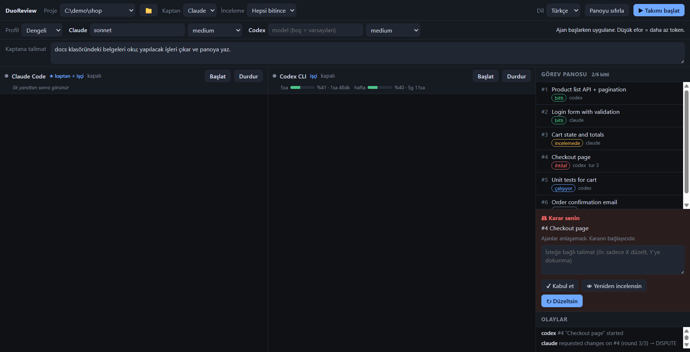

# DuoReview

**Claude Code ve Codex işi bölüşsün, birbirinin işini incelesin, anlaşamazlarsa son kararı sana bıraksın.**

[English](README.md) · MIT · Node ≥ 22.13 · Windows ✔ · macOS/Linux: denenmedi, bkz. [Sınırlar](#sınırlar)


*Ekran görüntüsü örnek verilerle hazırlanmıştır.*

DuoReview bir [MCP](https://modelcontextprotocol.io) sunucusu ve küçük bir Electron uygulamasıdır.
`claude` ve `codex` CLI'larını yan yana iki terminalde çalıştırır ve ikisine ortak bir görev panosu verir.

## Neden

Kodu yazan model kendi kodunu incelediğinde kendi ödevini notlandırmış olur. Farklı şirketlerin modellerinin
kör noktaları farklıdır. Bu yüzden burada **Claude'un işini Codex, Codex'in işini Claude inceler**.

- **Kaptan + işçi.** Bir ajan (hangisi olacağını sen seçersin) talimatını okuyup küçük görevlere böler. Sonra ikisi de panodan çalışır.
- **Çapraz inceleme.** Kimse kendi görevini incelemez. Yalnız `blocker` / `major` bulgular görevi durdurur, küçük notlar durdurmaz.
- **Beraberlikte karar sende.** 3 inceleme turunda uzlaşılamazsa görev *ihtilaf* olur: kabul et, yeniden incelet ya da talimatınla geri gönder.
- **Dosya çakışma koruması.** Her görev dokunacağı dosyaları bildirir. Ortağın bitmemiş görevine çakışan bir göreve başlanamaz.
- **Kota farkındalığı.** 5 saatlik ve haftalık kullanım göstergesi vardır. Kota dolunca uygulama o ajanı dürtmeyi bırakır, boşuna token yakmaz.
- **Token tasarrufu.** Görev tarifi oturumda bir kez gider, cevaplar küçüktür. Ekonomik / dengeli / güçlü profiller tek tıkla seçilir.
- **Global ayarlarına dokunmaz.** MCP bağlantısı oturum başına verilir (Claude'a `--mcp-config`, Codex'e `-c`). Pano verisi projenin dışında tutulur, reponun kirlenmez.
- **Türkçe ve İngilizce** arayüz, prompt ve araç metinleri (üst çubuktaki dil menüsü).

## Hızlı başlangıç

Gerekenler: Node.js ≥ 22.13, kurulu ve giriş yapılmış `claude` ve `codex` CLI'ları.

```powershell
npm install
npm run app -- --project "C:\projenin\yolu"
```

Kaptanı seç, talimatı yaz ("giriş sayfası ve testlerini ekle") ve **Takımı başlat**'a bas.
Uygulama iki ajanı proje klasöründe başlatır, MCP sunucusunu bağlar ve protokolü gönderir.

| Komut | Ne yapar |
|---|---|
| `npm run build` | MCP sunucusunu derler (`tsc`) |
| `npm start` | MCP sunucusunu tek başına çalıştırır (`AGENT_ID` ve `DUOREVIEW_DIR` gerekir) |
| `npm test` | Derler ve tüm testleri çalıştırır (model kotası harcamaz) |

Uygulama olmadan MCP kullanımı ve ayar örneği için [İngilizce README](README.md#using-the-mcp-server-without-the-app) bölümüne bak.
Ajanların izlediği döngü [TEAM.md](TEAM.md) dosyasındadır.

## Sınırlar

- **Windows**'ta geliştirildi ve denendi. macOS/Linux'ta `claude`/`codex` `PATH` üzerinden aranır, ama gerçek bir Mac veya Linux makinede henüz çalıştırılmadı (CI, Electron gerektirmeyen testleri Ubuntu'da koşar). Geri bildirim memnuniyetle.
- CLI alışılmadık bir yere kurulduysa yolu ver: `DUOREVIEW_CLAUDE_BIN=/yol/claude`, `DUOREVIEW_CODEX_BIN=/yol/codex`.
- İki ajan aynı çalışma klasörünü paylaşır (çakışma git worktree ile değil, `touches` denetimiyle önlenir).
- Tam iki ajan: Claude Code ve Codex CLI.
- Şimdilik yalnız kaynak koddan dağıtım: klonla, `npm install` ve `npm run app`. npm paketi veya kurulum dosyası henüz yok.
- `node:sqlite` Node'da hâlâ deneysel, bu yüzden bir uyarı görürsün.

## Güvenlik

Ajanlar **senin** kullanıcı haklarınla **senin** proje klasöründe çalışır. Codex'te DuoReview MCP araçları otomatik onaylıdır
(`default_tools_approval_mode="approve"`), Claude'da yalnız `mcp__duoreview` araçları önceden izinlidir. Diğer her şey CLI'ların
normal onay sorularından geçer. Hakem, bir onay sorusuna senin yerine Enter'a basmaz.
Kimlik bilgileri CLI'ların kendi kayıtlarında (`~/.claude`, `~/.codex`) kalır; DuoReview bunları okumaz, saklamaz, göndermez (göstergeler için yalnız yerel Codex oturum günlüklerinden kullanım yüzdelerini okur, ağa hiç çıkmaz).
Bir kodlama ajanının düzenlemesine razı olacağın projelerde kullan, commit ve push'u elle yap.

## Yol haritası

- Ajan başına git worktree, diff görünümü ve birleştirme adımı
- "Doğrulama komutu" kapısı (build ve testler geçmeden görev incelemeye girmesin)
- macOS/Linux desteği
- Daha fazla ajan (Gemini CLI, …)

## Lisans

[MIT](LICENSE)
