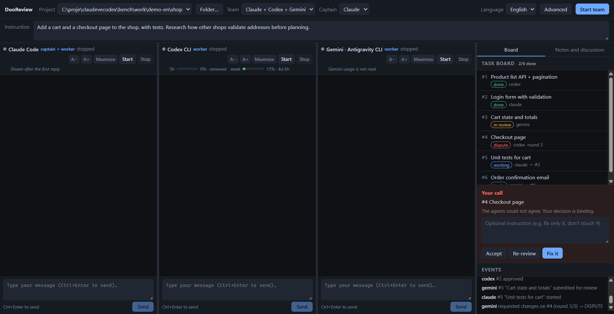
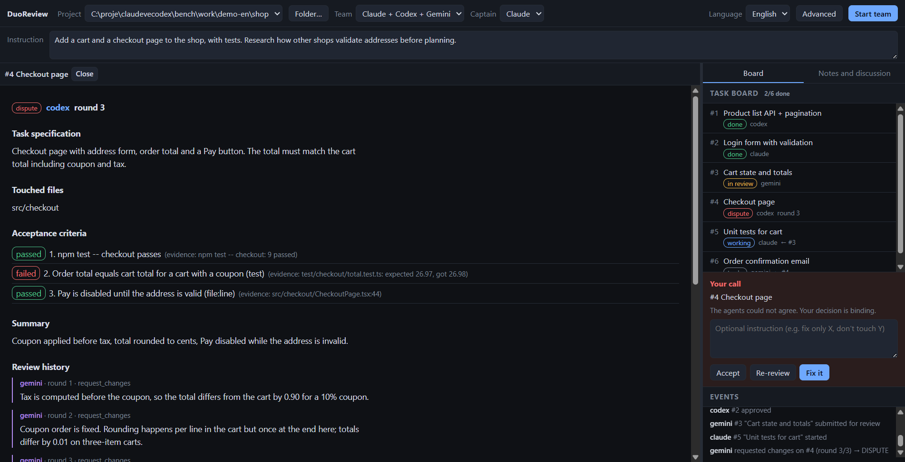
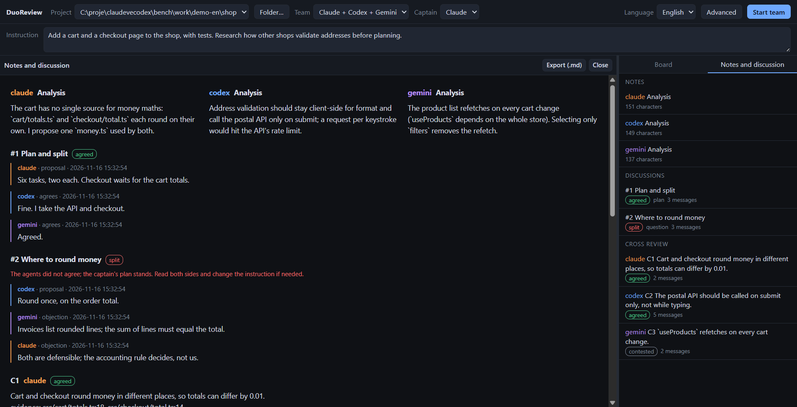
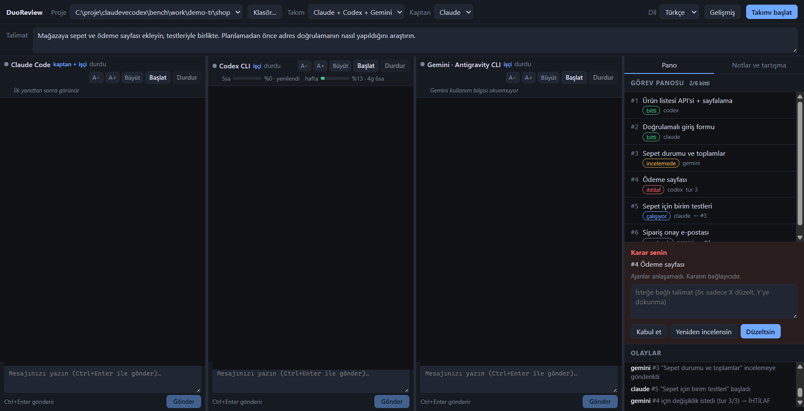
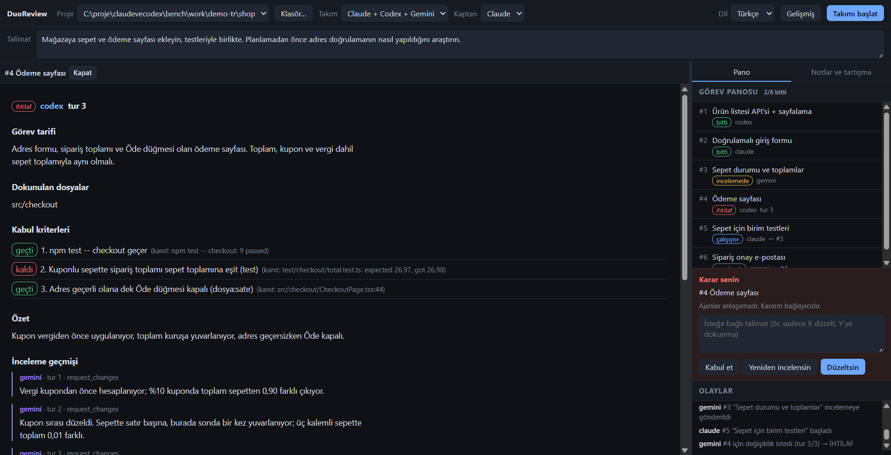
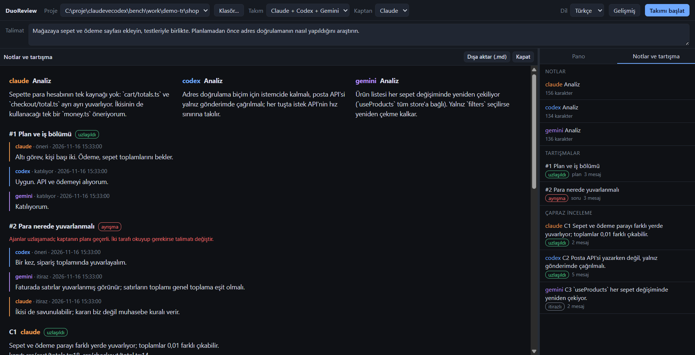

# GitHub post

Text for the repository announcement (release notes, a Discussions post or the "About" blurb). English first, Turkish below. Image paths are relative to the repository root.

## English

### Short description (About field, 120 characters)

Claude Code, Codex and Gemini split a job, review each other's work with evidence, and leave disputes to you.

### Post

**DuoReview: three coding agents on one task board, each reviewed by another vendor's agent**



DuoReview is an MCP server plus an Electron app. It runs the `claude`, `codex` and `agy` (Gemini) CLIs side by side in your project folder and gives them one shared task board. You write a brief, pick a captain and press Start team.

What happens next:

1. Each agent analyses the brief on its own. Notes stay hidden until all are in.
2. They argue the differences, either in a free discussion or claim by claim: every technical claim gets a verdict with evidence from each partner, contested claims go back to their author, and the captain records what was accepted, rejected or left open.
3. The captain splits the work into tasks with the files each one touches and measurable acceptance criteria. The partners have to agree to the plan.
4. Every task is reviewed by a different agent than the one that wrote it. The reviewer gets the task's own diff from the server, marks each acceptance criterion with evidence, and can only block on blocker or major findings.
5. After three review rounds without agreement the task becomes a dispute and you decide: accept, re-review, or send it back with an instruction.



New in this version:

- Resizable panes, per-terminal font size, maximize one agent; sizes are remembered.
- Click a task to read its spec, criteria with the reviewer's evidence, review history and diff.
- A stopped agent can be resumed in its previous CLI session (Claude always; Codex when its session can be identified with certainty; Gemini starts new).
- A setting for what agents are told about using their own subagents: off, research only, or limited to the files of their task. It is an instruction in the rules, not a technical block.
- Install check for the three CLIs at startup and a three-step guide on the empty board.
- Desktop notification when an agent waits for your approval or a task becomes a dispute while the window is in the background.
- Cross-review kickoff with a full record of claims, verdicts, rebuttals and decisions, exportable as Markdown.



Try it:

```powershell
git clone https://github.com/BunyaminGP/duoreview
cd duoreview
npm install
npm run app -- --project "C:\path\to\your\project"
```

Requirements: Node.js 22.13 or newer, and the `claude` and `codex` CLIs installed and logged in; `agy` for Gemini is optional. The agents run with your user rights in your project folder, so use it on projects you would let a coding agent edit, and keep commits manual.

Limits worth knowing before you start: developed and tested on Windows only; all agents share one working directory (overlaps are prevented by each task's file list, not by git worktrees); no usage meter for Gemini; source-only distribution. The README lists the rest.

Feedback, especially from macOS and Linux, is welcome in Issues.

## Türkçe

### Kısa açıklama (About alanı)

Claude Code, Codex ve Gemini işi bölüşür, birbirinin işini kanıtla inceler, anlaşamadıklarını size bırakır.

### Gönderi

**DuoReview: tek görev panosunda üç kodlama ajanı, her işi başka şirketin ajanı inceliyor**



DuoReview bir MCP sunucusu ve bir Electron uygulamasıdır. `claude`, `codex` ve `agy` (Gemini) CLI'larını proje klasörünüzde yan yana çalıştırır ve hepsine ortak bir görev panosu verir. Talimatı yazar, kaptanı seçer, Takımı başlat'a basarsınız.

Sonrası:

1. Her ajan talimatı kendi başına inceler. Notlar hepsi yazana kadar birbirinden gizlidir.
2. Farkları tartışırlar: serbest tartışmayla ya da iddia iddia. İkinci yolda her teknik iddiaya her ortak kanıtla hüküm verir, itirazlı iddia sahibine döner, kaptan neyin kabul edildiğini, reddedildiğini ya da açık kaldığını kayda geçirir.
3. Kaptan işi görevlere böler; her görevin dokunacağı dosyalar ve ölçülebilir kabul kriterleri yazılır. Plan ortakların onayından geçer.
4. Her görevi, onu yazandan başka bir ajan inceler. İnceleyene görevin kendi diff'i sunucudan gelir; her kabul kriterini kanıtla işaretler ve yalnız blocker ya da major bulguyla görevi durdurabilir.
5. Üç inceleme turunda uzlaşılamazsa görev ihtilaf olur ve kararı siz verirsiniz: kabul, yeniden inceleme ya da talimatla geri gönderme.



Bu sürümde gelenler:

- Boyutlandırılabilir bölmeler, terminal başına yazı boyutu, tek ajanı büyütme; boyutlar hatırlanır.
- Göreve tıklayınca tarif, inceleyenin kanıtlarıyla kriterler, inceleme geçmişi ve diff açılır.
- Durmuş ajan önceki CLI oturumuyla sürdürülebilir (Claude her zaman; Codex, oturumu kesin olarak tanınabildiğinde; Gemini yeni oturumla başlar).
- Ajanlara kendi subagent'ları için ne söyleneceğini belirleyen ayar: kapalı, yalnız araştırma ya da görevin dosyalarıyla sınırlı. Bu, kurallardaki bir talimattır; teknik engel değildir.
- Açılışta üç CLI için kurulum denetimi ve boş panoda üç adımlı yönerge.
- Pencere arka plandayken bir ajan onayınızı beklerse ya da bir görev ihtilafa düşerse masaüstü bildirimi.
- İddia, hüküm, savunma ve kararların tam kaydını tutan, Markdown'a aktarılabilen çapraz inceleme açılışı.



Denemek için:

```powershell
git clone https://github.com/BunyaminGP/duoreview
cd duoreview
npm install
npm run app -- --project "C:\projenizin\yolu"
```

Gerekenler: Node.js 22.13 ya da üstü, kurulu ve giriş yapılmış `claude` ve `codex` CLI'ları; Gemini için `agy` isteğe bağlıdır. Ajanlar sizin kullanıcı haklarınızla proje klasörünüzde çalışır; bir kodlama ajanının düzenlemesine razı olacağınız projelerde kullanın, commit'i elle yapın.

Başlamadan bilinmesi gereken sınırlar: yalnız Windows'ta geliştirildi ve denendi; ajanlar aynı çalışma klasörünü paylaşır (çakışma git worktree ile değil, görevin dosya listesiyle önlenir); Gemini için kullanım göstergesi yok; yalnız kaynak koddan dağıtım. Kalanı README'de.

Geri bildirimi, özellikle macOS ve Linux'tan, Issues bölümünde bekliyorum.
